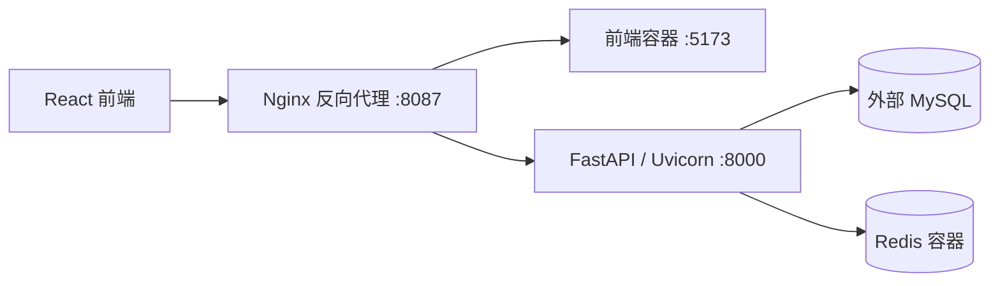

# SMTMS 技術架構文件

## 整體技術堆疊
- **前端**：React 19、TypeScript、Vite 8、React Router 7、Tailwind CSS 4
- **後端**：Python 3.12+/FastAPI/Pydantic 2/SQLAlchemy 2/Alembic/Uvicorn
- **資料庫**：MySQL 8（外部）、Redis 7（用於JWT撤銷）
- **部署**：Docker Compose（Redis、後端、前端、Nginx）

## 系統架構圖


## 專案目錄結構
```
backend/                 # FastAPI 後端
  app/api/routes/         # API 路由 (auth.py, suppliers.py, materials.py, quality.py, audit.py...)
  app/models/             # SQLAlchemy 模型
  app/services/           # 業務服務 (audit.py, auth.py...)
  app/core/               # 核心功能 (security.py...)
  tests/                  # 後端測試
frontend/                # React/TypeScript 前端
  src/pages/              # 頁面元件
  src/api/                # API 客戶端
docker/nginx/            # Nginx 設定
docker-compose.yml       # 容器编排
docs/                    # 正式文件 (SRS, DOMAIN_RULES, API_CONTRACT, DATABASE_SCHEMA...)
.ai/                     # AI Coding Context 文件
```

## 核心模組關係
1. **認證授權模組**：JWT+Redis實作Token管理，RBAC權限控制
2. **基礎資料模組**：供應商、物料管理，供貨關聯維護
3. **品質流程模組**：收料、批次拆分、IQC檢驗、不合格品管理
4. **追溯查詢模組**：跨模組關聯查詢，實現物料全程追溯
5. **稽核紀錄模組**：ORM異動記錄、CSV匯出，權限保護