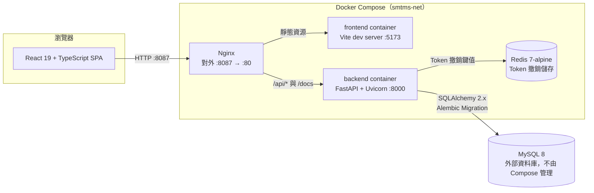
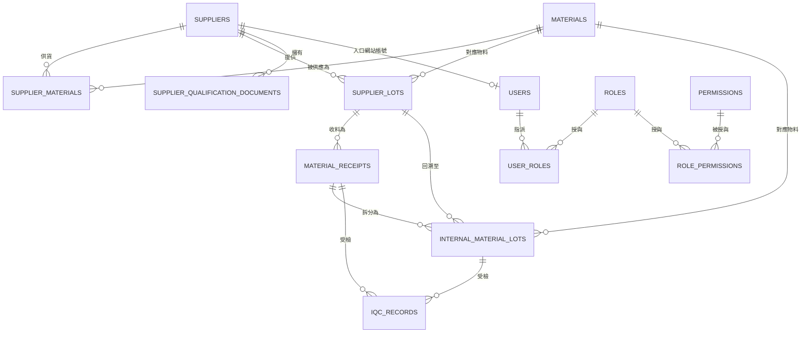
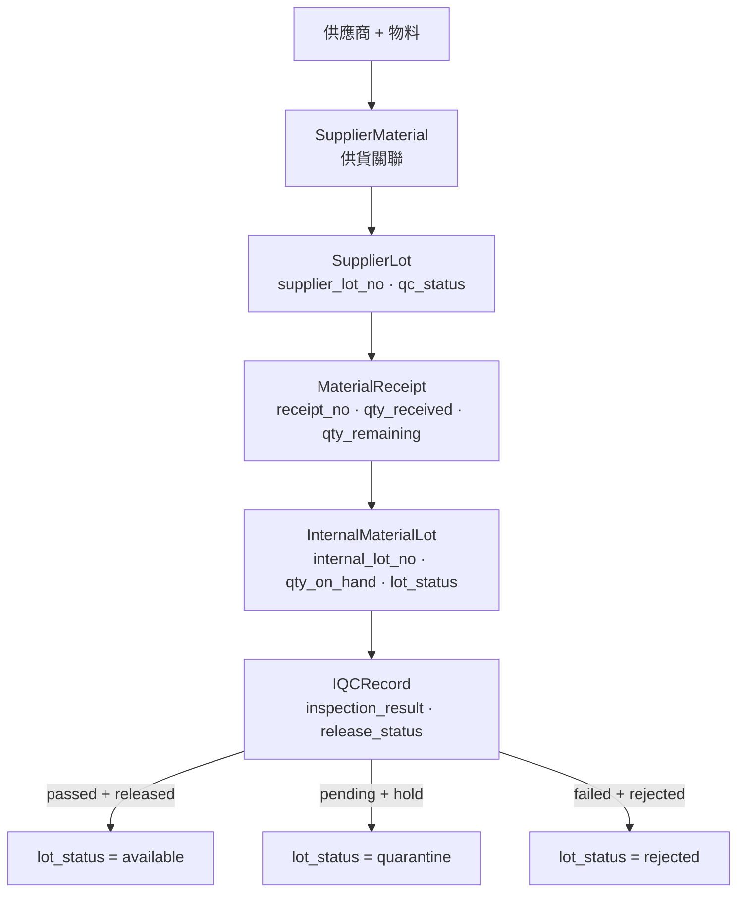

# SMTMS — 供應商物料追溯暨品保管理系統

Supplier Material Traceability Management System（供應商 · 物料 · 追溯 · 品保）。

SMTMS 把「供應商出貨的內容」與「廠內實際檢驗的結果」串在一起：將供應商主檔、收料紀錄、廠內追蹤批號與
IQC（進料品質檢驗）結果，收斂在同一條具關聯性、可稽核的追溯鏈上。它存在的目的，是取代以試算表為主的
人工作業——在那些流程裡，供應商批號、廠內批號與檢驗結果容易散失、難以對帳。

> 本文件僅描述目前實際已提交的內容。完整規格請見 [spec.md](spec.md)；後端與前端細節分別見
> [backend/README.md](backend/README.md) 與 [frontend/README.md](frontend/README.md)。

---

## 1. 專案總覽

**要解決的問題**

| 人工作業的痛點                              | SMTMS 的處理方式                                                                    |
| ------------------------------------------- | ----------------------------------------------------------------------------------- |
| 供應商與物料資料散落於各檔案                | 單一供應商／物料目錄，並以 `supplier_materials` 表達供貨關聯                        |
| 供應商批號與廠內追蹤批號缺乏明確關聯        | `supplier_lots` 與 `internal_material_lots` 為各自獨立、以外鍵串接的實體            |
| 收料、批次拆分與 IQC 結果難以串成完整追溯鏈 | `material_receipts → internal_material_lots → iqc_records` 形成可雙向回溯的關聯鏈   |
| 人工 Excel 維護容易與現況不一致             | 具驗證機制的供應商 Excel 匯入（預覽 → 確認寫入），以及受保護、具冪等性的開發 Seeder |

**本 Repository 的範圍：** FastAPI + MySQL 後端、React + TypeScript 前端，以及 Docker Compose 部署
（內含 Redis 與 Nginx）。MySQL 視為**外部**資料庫，不由 Compose 建立。

---

## 2. 架構總覽



請求方向：瀏覽器只與 Nginx 溝通。Nginx 將 `/api/*` 與 `/docs` 代理至後端，其餘流量導向前端。後端是唯一
會連線 MySQL 與 Redis 的元件。

**後端實際存在的分層**（`backend/app/`）：

- `api/routes/` — HTTP 路由（`auth`、`health`、`suppliers`、`materials`、`quality`）
- `core/` — 設定（`config.py`）、JWT/RBAC 相依（`security.py`）、Redis 客戶端（`redis_client.py`）
- `models/` — SQLAlchemy ORM 模型（`user.py`、`quality.py`）
- `schemas/` — Pydantic 請求／回應契約（`auth.py`、`catalog.py`）
- `services/` — `supplier_import.py`（Excel 解析／驗證／寫入）
- `db/` — engine、session factory、宣告式 `Base`

除了 Excel 匯入服務之外，並沒有額外獨立的 repository / service 抽象層；路由直接使用 SQLAlchemy session。
這在目前範圍內是有意為之，並已記錄於 [§11](#11-已知限制)。

---

## 3. Domain Model（領域模型）



**實體責任**

| 實體                                        | 含義                                                                             | 主要關聯                                           |
| ------------------------------------------- | -------------------------------------------------------------------------------- | -------------------------------------------------- |
| `Supplier`（供應商）                        | 供應商主檔（`supplier_code`、`tax_id`、聯絡資訊、狀態）                          | 1→N 供應商批號、收料、文件；0→1 入口網站帳號       |
| `Material`（原物料）                        | 物料主檔（`material_code`、`material_type`、`uom`）                              | 1→N 供貨關聯、批號、廠內批次                       |
| `SupplierMaterial`（供應商供貨關聯）        | 哪個供應商供應哪個物料；含 `is_preferred` 旗標                                   | 唯一鍵（`supplier_id`、`material_id`）             |
| `SupplierLot`（供應商批號）                 | 供應商所宣告的批號，含 `qc_status`                                               | 隸屬於一位供應商 + 一項物料                        |
| `MaterialReceipt`（收料事件）               | **實際的收料事件**：`receipt_no`、`received_at`、`qty_received`、`qty_remaining` | 指向供應商、物料與 `supplier_lot`                  |
| `InternalMaterialLot`（廠內追蹤單位）       | 由收料拆分而生的廠內追蹤單位：`internal_lot_no`、`qty_on_hand`、`lot_status`     | 指回 `receipt_id` 與 `supplier_lot_id`             |
| `IQCRecord`（來料檢驗紀錄）                 | 檢驗紀錄，含 `inspection_result` 與 `release_status`                             | 關聯至收料與／或廠內批次；記錄 `inspector_user_id` |
| `SupplierQualificationDocument`（資格文件） | 供應商證書紀錄（`doc_type`、`expires_at`、`status`）                             | 目前 API 僅提供讀取（見 [§11](#11-已知限制)）      |
| `User / Role / Permission`                  | RBAC 關聯圖：`user_roles` 與 `role_permissions` 中介表                           | 權限於每次請求時自這些表解析                       |

**追溯鏈的閱讀方式**

- `SupplierLot` 回答：**「供應商宣告的批號是什麼？」**
- `MaterialReceipt` 回答：**「我們實際在何時、收了多少？」**
- `InternalMaterialLot` 回答：**「廠內實際追蹤的單位是什麼？」** 並保留指回收料與供應商批號的指標，因此廠內
  批次可回溯至其供應商與收料來源。
- `IQCRecord` 回答：**「檢驗判定結果是什麼？」** 並掛載於收料與／或廠內批次；由於廠內批次會連回供應商批號
  與收料，因此 IQC 結果可追溯到供貨的供應商與該收料事件。
- **拆分：** 一筆收料可拆分為多筆廠內批次。拆分數量加總會與該收料的剩餘數量進行驗證，且 `qty_remaining`
  會在同一交易內遞減。

並非每個欄位都由資料庫層強制約束（例如多數狀態欄位是純字串而非 enum）；凡涉及此點之處，會於
[§7](#7-技術決策) 與 [§11](#11-已知限制) 明確說明。

---

## 4. 物料追溯流程



**程式碼中實際使用的狀態值**（為字串，非資料庫 enum）：

| 欄位                                | 位置       | 應用程式使用的值                                                 |
| ----------------------------------- | ---------- | ---------------------------------------------------------------- |
| `supplier_lots.qc_status`           | 供應商批號 | 預設 `received`；Seeder 另使用 `passed` / `pending` / `failed`   |
| `material_receipts.status`          | 收料       | 預設 `received`                                                  |
| `internal_material_lots.lot_status` | 廠內批次   | `available`、`quarantine`、`rejected`（新建批次為 `quarantine`） |
| `iqc_records.inspection_result`     | IQC        | `pending`、`passed`、`failed`                                    |
| `iqc_records.release_status`        | IQC        | `hold`、`released`、`rejected`                                   |

**由 API 強制執行的檢驗／放行規則**（`backend/app/api/routes/quality.py`）：IQC 結果與放行狀態僅接受以下三種
配對，並同步更新所連結廠內批次的 `lot_status`：

| `inspection_result` | 必須搭配的 `release_status` | 更新後的 `internal_material_lots.lot_status` |
| ------------------- | --------------------------- | -------------------------------------------- |
| `passed`            | `released`                  | `available`                                  |
| `pending`           | `hold`                      | `quarantine`                                 |
| `failed`            | `rejected`                  | `rejected`                                   |

新拆分的廠內批次起始為 `quarantine`；唯有 `passed` + `released` 的檢驗結果才會將其轉為 `available`。這三組
配對是 API 唯一接受的組合，其餘組合會被拒絕。

---

## 5. 授權模型

- **身分驗證：** 帳號／密碼 → JWT（HS256，`PyJWT`）。Token 帶有 `sub`、`user_id`、`iat`、`exp` 與 `jti`。
  密碼以 bcrypt（透過 `passlib`）驗證。
- **Token 撤銷：** 登出時將該 Token 的 `jti` 以 `auth:revoked:{jti}` 寫入 Redis，TTL 等同該 Token 的剩餘
  效期。每個受保護請求都會檢查此鍵值。
- **RBAC：** 角色與權限採正規化資料表（`roles`、`permissions`、`user_roles`、`role_permissions`）。
  `get_current_user` 於每次請求時自資料庫解析呼叫者的角色名稱與權限代碼，再由 `require_permission(...)`
  逐端點強制檢查。權限以代碼引用（例如 `suppliers:read`、`receipts:write`、`iqc:read`）。
- **供應商資料隔離：** 使用者若設有 `users.supplier_id`，即為 **Supplier Portal User**。`GET /suppliers` 與
  `GET /supplier-lots` 的查詢會被過濾至該供應商；`ensure_supplier_access()` 會以 `403` 拒絕存取其他供應商的
  紀錄。
- **首次登入強制改密：** 由 Excel 匯入建立的供應商帳號會帶有 `must_change_password = true`。所有受權限保護
  的端點（`require_permission()`）在密碼變更前都會以 `403` 拒絕；`POST /auth/change-password` 刻意豁免，
  以便使用者完成變更。（`require_role()` 相依套用相同閘道，但目前沒有任何路由使用它。）

**已驗證的供應商權限行為**（由 `tests/test_supplier_isolation.py` 涵蓋）：

- Supplier Portal User 角色僅被授與 `suppliers:read`。
- 供應商帳號僅能讀取其自身的供應商紀錄。
- 存取其他供應商的紀錄會被拒絕（`403`）。
- 首次登入時，須先完成密碼變更才能使用其他端點。

執行中的應用程式實際建立並驗證的角色只有 **Supplier Portal User**（由匯入流程與 Seeder 建立）。其他更廣泛的
角色（例如「Admin」或「Warehouse」）**不屬於**已實作且已驗證的行為，僅出現於 [§12](#12-後續規劃)。開發
Seeder 另會建立三個 `SMTMS Seed …` 角色，但那些是本地開發用的固定資料，並非正式角色。

---

## 6. API 設計

- 所有受保護路由採 JWT Bearer 驗證。
- 資源導向路徑，統一置於 `/api/v1` 前綴下。
- 以 Pydantic 模型進行請求／回應驗證；OpenAPI 文件由 FastAPI 產生。
- 錯誤回應採用 FastAPI 標準結構 `{"detail": ...}`（`HTTPException` 時 `detail` 為字串，請求驗證錯誤時為
  陣列），前端客戶端已依賴此結構。

代表性路由（皆為實際路徑與 HTTP 方法；完整契約請見 [spec.md](spec.md)）：

| 領域       | 方法與路徑                                                                                                           | 備註                                    |
| ---------- | -------------------------------------------------------------------------------------------------------------------- | --------------------------------------- |
| Auth       | `POST /auth/login`、`POST /auth/logout`、`GET /auth/me`、`POST /auth/change-password`                                | 簽發／撤銷 JWT、個人資料、強制改密      |
| Suppliers  | `GET /suppliers`、`POST /suppliers`、`GET /suppliers/{id}`、`PATCH /suppliers/{id}`                                  | 列表對入口網站使用者會依供應商過濾      |
| Suppliers  | `GET /suppliers/{id}/documents`                                                                                      | 僅讀取的文件列表                        |
| Suppliers  | `POST /suppliers/{id}/materials`、`DELETE /suppliers/{id}/materials/{material_id}`                                   | 維護供貨關聯                            |
| 供應商匯入 | `GET /suppliers/import/template`、`POST /suppliers/import/preview`、`POST /suppliers/import/confirm`                 | 下載範本、驗證、寫入                    |
| Materials  | `GET /materials`、`POST /materials`、`GET /materials/{id}`、`PATCH /materials/{id}`、`GET /materials/{id}/suppliers` |                                         |
| Receipts   | `GET /receipts`、`POST /receipts`、`GET /receipts/{id}`                                                              |                                         |
| 廠內批次   | `GET /internal-lots`、`GET /internal-lots/{id}`、`POST /receipts/{id}/internal-lots`                                 | 將收料拆分為廠內批次                    |
| 供應商批號 | `GET /supplier-lots`                                                                                                 | 僅列表——供應商批號目前無法透過 API 建立 |
| IQC        | `GET /iqc`、`POST /iqc`、`GET /iqc/{id}`、`PATCH /iqc/{id}`                                                          |                                         |
| Health     | `GET /health`、`GET /health/live`、`GET /health/ready`、`GET /health/database`、`GET /health/redis`、`GET /ready`    | 存活／就緒檢查                          |

並非每個資源都是完整的 CRUD。例如供應商、物料、收料與廠內批次都沒有 `delete`，而供應商批號目前也沒有建立
端點。

---

## 7. 技術決策

### 廠內批次（`InternalMaterialLot`）

- **背景：** 一筆實體收料常會被拆分至不同儲位或產線，因此單憑供應商批號無法辨識架上實際的庫存。
- **決策：** 將廠內追蹤單位建模為獨立實體（`internal_material_lots`），同時指回 `receipt_id` 與
  `supplier_lot_id`。
- **解決的問題：** 讓庫存擁有廠內自有的識別身分，同時保留與供應商批號及收料事件的連結，使 IQC 結果仍可回溯
  至來源。
- **限制：** 廠內批次是透過**拆分收料**建立的。目前尚無獨立的批次衍生，或可一次取得完整追溯鏈的查詢端點。

### JWT + Redis 撤銷機制

- **背景：** 無狀態 JWT 若無伺服器端狀態，無法在登出時即時失效。
- **決策：** JWT 維持短效期，並將撤銷的 `jti` 存入 Redis，TTL 對應 Token 到期時間。
- **解決的問題：** 登出（及強制重新驗證）能立即生效。
- **取捨：** 若 Redis 無法使用，撤銷檢查會以**失效即拒絕（fail-closed）**方式處理——受保護端點回傳
  `503 Authentication service unavailable`，而非略過檢查。此設計以安全性優先於可用性，並使 Redis 成為已驗證
  流量下的硬相依。

### 關聯式資料庫

- **背景：** 此領域是一張由外鍵構成的網路（收料、批次、檢驗、RBAC）。
- **決策：** 採用 MySQL，搭配 SQLAlchemy 2.x 模型與 Alembic 進行結構版本控管。
- **解決的問題：** 提供參考完整性，並可雙向走訪整條追溯鏈。
- **限制：** 部分業務狀態以純 `String` 欄位儲存而非資料庫 enum，因此一部分狀態規則是由應用程式碼而非結構
  強制。

### 供應商 Excel 匯入

- **背景：** 以試算表進行供應商建檔是常見的人工步驟，容易產生不一致的資料。
- **決策：** 三步驟流程——下載範本 → `preview`（解析 + 驗證）→ `confirm`（寫入）。
- **解決的問題：** 驗證錯誤會在**寫入任何資料之前**，以列號與欄位名稱回報；重複資料（供應商代碼、`tax_id`、
  登入帳號）於驗證階段即被偵測；未提供密碼的帳號會回傳一次性產生的密碼。
- **可靠性：** 寫入路徑（`execute_supplier_import`）以單一資料庫交易執行——供應商不會在缺少登入帳號的情況下
  被建立，失敗時整批回滾。檔案限制會被強制（僅 `.xlsx`、≤ 5 MB、≤ 1000 筆資料列）。

### `AUTO_INCREMENT`

- **背景：** 先前的 Migration（`20261019_add_mysql_comments_first_schema`）以 `MODIFY COLUMN` 重新宣告主鍵，
  導致十三張表的主鍵 `AUTO_INCREMENT` 屬性被無聲移除。
- **決策：** `20261019_autoincrement_pks` 還原所有主鍵的 `AUTO_INCREMENT`（過程中先卸除、再重建受影響的外鍵）。
- **解決的問題：** 從結構面移除主鍵撞號的根因；此 Migration 具回溯相容性，因為 MySQL 在 `AUTO_INCREMENT`
  欄位上仍接受明確指定的 `id`。
- **限制（技術債）：** 應用程式碼在供應商、物料、品保與匯入等寫入路徑中，仍以 `_next_id()` 預先計算
  `MAX(id) + 1`。結構面的修正已就位，但這些呼叫點**尚未**切換，因此結構層級的競態已修復，應用層級的模式仍
  存在。參見 [§11](#11-已知限制) 與 [§12](#12-後續規劃)。

### FastAPI + React

- **背景：** 後端是驗證與授權的唯一真實來源；前端是輕量的操作介面。
- **決策：** 採用 FastAPI（Pydantic 驗證 + 自動產生 OpenAPI）與 React + TypeScript SPA。
- **解決的問題：** 共用請求／回應契約、`/docs` 的互動式 API 文件，以及清楚的分離：後端負責強制規則，前端
  僅呈現結果。

---

## 8. 安全性與可靠性

| 能力                             | 狀態           | 佐證                                                      |
| -------------------------------- | -------------- | --------------------------------------------------------- |
| 密碼雜湊（bcrypt）               | 已實作         | `app/core/security.py`                                    |
| JWT 身分驗證                     | 已實作並已測試 | `tests/test_jwt_rbac.py`                                  |
| 以權限代碼進行的 RBAC            | 已實作並已測試 | `require_permission()` + `test_jwt_rbac.py`               |
| 供應商資料隔離                   | 已實作並已測試 | `ensure_supplier_access()` + `test_supplier_isolation.py` |
| Redis Token 撤銷（含失效即拒絕） | 已實作         | Redis 無法連線時 `get_current_token_claims()` 回傳 `503`  |
| 首次登入強制改密                 | 已實作並已測試 | `security.py` 的閘道；由隔離測試涵蓋                      |
| 資料庫 Migration（Alembic）      | 已實作         | `backend/alembic/versions/`                               |
| 健康／就緒檢查                   | 已實作         | `app/api/routes/health.py`                                |
| 交易處理（拆分、匯入）           | 已實作並已測試 | 拆分僅提交一次；匯入回滾由 `test_supplier_import.py` 涵蓋 |

上表描述的是「有程式碼或測試佐證」的特性。這**不代表**已具備完整的企業級安全、完整稽核日誌或災難復原能力
——詳見 [§11](#11-已知限制)。

---

## 9. 已實作功能

- **身分驗證與授權** — 登入、登出（Redis 撤銷）、目前使用者資料、以權限保護的路由。
- **供應商與物料管理** — 列表／明細／建立／更新、關鍵字搜尋、伺服器端分頁。
- **供應商–物料供貨關聯** — 新增／移除，並確保每項物料僅有一位偏好供應商。
- **供應商批號、收料與廠內批次** — 收料登錄並追蹤剩餘數量、將收料拆分為廠內批次、批次列表。
- **IQC 紀錄** — 建立／更新檢驗，且強制執行結果／放行配對，連動廠內批次狀態。
- **供應商帳號與資料隔離** — 以 `supplier_id` 限縮的入口網站帳號，並強制首次改密。
- **Excel 供應商匯入** — 範本下載、預覽驗證、交易式確認寫入。
- **開發種子資料與測試帳號** — 冪等、非破壞性的 Seeder，以及範例匯入活頁簿。
- **部署與可觀測性** — Docker Compose（backend、frontend、Redis、Nginx）、健康／就緒端點、`/docs` 的
  OpenAPI 文件。

---

## 10. 驗證

以下結果為**本次文件改版期間（2026-10-19）**重新執行所得（Windows、PowerShell，專案根目錄
`C:\laragon\www\smtms`）：

| 檢查項目            | 指令                                                     | 結果                                                 |
| ------------------- | -------------------------------------------------------- | ---------------------------------------------------- |
| 後端測試            | `cd backend && uv run pytest -q`                         | **45 passed**                                        |
| 前端測試            | `cd frontend && npm test`                                | **7 passed**（2 個檔案）                             |
| 前端建置 + 型別檢查 | `cd frontend && npm run build`（`tsc -b && vite build`） | 通過                                                 |
| Ruff Lint           | `cd backend && uv run ruff check .`                      | **未通過——309 項**（300 `E501`、7 `I001`、2 `F401`） |

**範圍與誠實說明**

- 後端測試以**記憶體內 SQLite** 搭配 fake Redis 客戶端執行（見 `tests/test_supplier_isolation.py`、
  `test_catalog_api.py`、`test_quality_workflow_api.py`、`test_supplier_import.py`、`test_jwt_rbac.py` 中的
  fixtures）。它們屬於 API／單元層級測試，**並非** MySQL 整合測試。
- 實際 MySQL + Redis 的驗收（執行 Alembic、執行 `seed_dev.py`，並以真實資料庫走過供應商入口網站、強制改密、
  跨供應商拒絕，以及 `receipt → internal lot → IQC` 追溯鏈）是在先前的開發工作階段完成，**並未**於本次文件
  改版中重新執行。此部分應視為「先前已回報」，並於資料庫目標變更時重新確認。
- Ruff 之所以列入，是因為 `uv run ruff check .` 是文件化工作流程的一部分；它目前會回報問題，故列為已知事項，
  而非通過的檢查。

---

## 11. 已知限制

經複查，以下問題在目前程式碼中仍然成立：

- **應用程式碼仍存在 `MAX(id) + 1`** — 即使 `AUTO_INCREMENT` Migration 已套用，`suppliers.py`、
  `materials.py`、`quality.py` 與 `supplier_import.py` 仍使用 `_next_id()` 模式。
- **`supplier_qualification_documents` 沒有建立 API** — 文件僅能列表（`GET /suppliers/{id}/documents`），並由
  Seeder 填入。
- **供應商批號沒有建立 API** — 僅有 `GET /supplier-lots`；收料必須引用已存在的批號。
- **沒有統一的追溯查詢** — 沒有單一端點可回傳完整的
  供應商 → 批號 → 收料 → 廠內批次 → IQC 追溯鏈。
- **結構中沒有專屬的業務狀態約束** — 數個狀態欄位為自由文字 `String`，其允許值存在於應用程式碼中。
- **沒有異動稽核軌跡**，也沒有不合格品／矯正措施／CAPA 流程，且沒有備份自動化。
- **併發、負載與故障情境尚未驗證** — 尤其是仍走 `MAX(id) + 1` 路徑的並行新增。
- **`users:manage` 權限已定義但未使用** — Seeder 會建立它，但沒有任何路由強制檢查。

---

## 12. 後續規劃

依優先順序排列的未來工作。以下項目**目前尚未實作**。

1. 移除剩餘的 `MAX(id) + 1` 呼叫點，改依資料庫指派的 `AUTO_INCREMENT` 主鍵。
2. 強化資料一致性與併發保證，並補上跨關聯的驗證測試。
3. 新增品質異常處理、矯正措施與稽核軌跡。
4. 擴充整合測試（真實 MySQL + Redis），以及備份／還原與部署驗證。
5. 依需求擴充供應商文件管理與報表。

---

## 13. 本地開發

於 Windows + PowerShell 環境開發。請勿提交 `.env` 檔案或任何真實機密。

### 先決條件

- Python `>=3.12,<3.14` 與 [uv](https://docs.astral.sh/uv/)
- Node.js `^20.19.0`、`^22.12.0` 或 `>=24.0.0`，以及 npm
- 可連線的 MySQL 實例（外部），以及 Redis（使用 Docker 時由 Compose 提供）

### 後端設定

```powershell
cd backend
uv sync --group dev
copy .env.example .env
```

後端實際讀取的環境變數（來自 `backend/.env`）：

| 變數                          | 用途                                                                 |
| ----------------------------- | -------------------------------------------------------------------- |
| `APP_ENV`                     | 環境名稱（`development` / `test` / …）                               |
| `APP_NAME`                    | 應用程式名稱                                                         |
| `APP_DEBUG`                   | 除錯旗標                                                             |
| `API_V1_STR`                  | API 前綴（預設 `/api/v1`）                                           |
| `SECRET_KEY`                  | JWT 簽章金鑰——至少 32 字元，切勿提交真實值                           |
| `ALGORITHM`                   | JWT 演算法（預設 `HS256`）                                           |
| `ACCESS_TOKEN_EXPIRE_MINUTES` | Token 有效分鐘數                                                     |
| `DATABASE_URL`                | MySQL DSN，例如 `mysql+pymysql://<user>:<password>@<host>:3306/<db>` |
| `REDIS_URL`                   | Redis DSN                                                            |
| `CORS_ORIGINS`                | 允許的前端來源（JSON 陣列或逗號分隔）                                |

### 資料庫 Migration（Alembic）

Migration 鏈（head 以**粗體**標示）：

```
20261019_create_user_auth_tables
  → 20261019_comments_first_schema
  → 20261019_supplier_user_link
  → **20261019_autoincrement_pks**
```

```powershell
cd backend
uv run python -m alembic -c alembic.ini upgrade head   # 套用所有 migration
uv run python -m alembic -c alembic.ini current        # 顯示目前 revision
uv run python check_mysql_comments.py                  # MySQL 結構驗證輔助腳本
```

### 開發種子資料

`backend/scripts/seed_dev.py` 具冪等性且非破壞性：以穩定的 `SEED-*` 前綴為鍵進行 upsert、永不刪除資料，且若
業務鍵與非 Seeder 資料衝突時會中止。除非 `APP_ENV` 為 `development`/`test`、目標為 `localhost:3306/smtms`，
且結構位於預期 revision，否則它會拒絕執行。

```powershell
cd backend
uv run python scripts/seed_dev.py
```

它會建立內部測試帳號 `seed_admin`、`seed_qa_1`、`seed_qa_2`、`seed_receiver_1`，以及供應商入口網站帳號
`seed_supplier_001` … `seed_supplier_006`。這些帳號共用一組本地開發密碼，記錄於
[backend/README.md](backend/README.md)——僅供本地使用。可於單次工作階段以下列方式覆寫：

```powershell
$env:SMTMS_SEED_PASSWORD = "your-local-seed-password"
```

若要產生獨立的 Excel 匯入範例（無須資料庫）：

```powershell
cd backend
uv run python scripts/generate_import_samples.py
```

這會產生 `backend/samples/supplier_import_valid.xlsx`（可匯入的資料列）與
`backend/samples/supplier_import_errors.xlsx`（刻意驗證失敗的資料列）。

### 啟動後端

```powershell
cd backend
uv run uvicorn app.main:app --reload --host 0.0.0.0 --port 8000
```

OpenAPI 文件：<http://localhost:8000/docs>

### 啟動前端

```powershell
cd frontend
npm install
npm run dev
```

前端會呼叫 `VITE_API_BASE_URL`（預設 `http://localhost:8000`）。請只設定 API 的**來源（origin）**——客戶端會
自行附加 `/api/v1/...`。Vite 服務於 <http://localhost:5173>。

### 測試與 Lint

```powershell
cd backend
uv run pytest -q
uv run ruff check .
uv lock --check

cd ../frontend
npm test
npm run lint
npm run build
```

### Docker Compose 部署

Compose 會啟動 **backend**、**frontend**、**Redis** 與 **Nginx**。MySQL 為**外部**，不在此建立。

```powershell
cd C:\laragon\www\smtms
docker compose up --build
```

| 服務     | 容器             | 對外埠        | 備註                                                           |
| -------- | ---------------- | ------------- | -------------------------------------------------------------- |
| Nginx    | `smtms-nginx`    | `8087` → `80` | 進入點；`/api/*` → backend，`/` → frontend                     |
| Backend  | `smtms-backend`  | `8000`        | 讀取 `backend/.env`；`REDIS_URL` 覆寫為 `redis://redis:6379/0` |
| Frontend | `smtms-frontend` | `5173`        | Vite dev server                                                |
| Redis    | `smtms-redis`    | 內部 `6379`   | 未發佈對外埠                                                   |

請透過 Nginx 存取應用程式：<http://localhost:8087>。

若要讓後端容器連線至 Windows 主機上的 MySQL：容器的 `localhost` 是容器本身，因此需使用
`host.docker.internal`。後端進入點（`backend/docker-entrypoint.py`）會自動將本地的 `localhost`/`127.0.0.1`
MySQL 主機改寫為 `host.docker.internal`，而 `docker-compose.yml` 亦宣告了對應的 `extra_hosts` 設定。

```powershell
docker compose ps
docker compose logs backend
docker compose down
```

---

## 14. 專案結構

```text
SMTMS/
├── README.md                  # 本文件
├── spec.md                    # 規格的唯一真實來源
├── docker-compose.yml
├── docker/nginx/default.conf
├── backend/
│   ├── app/{api,core,db,models,schemas,services}/
│   ├── alembic/versions/
│   ├── scripts/{seed_dev.py,generate_import_samples.py}
│   ├── samples/
│   ├── tests/
│   ├── Dockerfile
│   ├── docker-entrypoint.py
│   └── pyproject.toml
└── frontend/
    ├── src/{api,components,lib,pages}/
    ├── Dockerfile
    └── package.json
```

若某項功能未反映在路由、schema、前端、migration 或測試中，就不應被描述為已實作。「已完成」、「已實作但尚未
完整驗證」與「尚未實作」三種狀態的定義，維護於 [spec.md](spec.md)。
