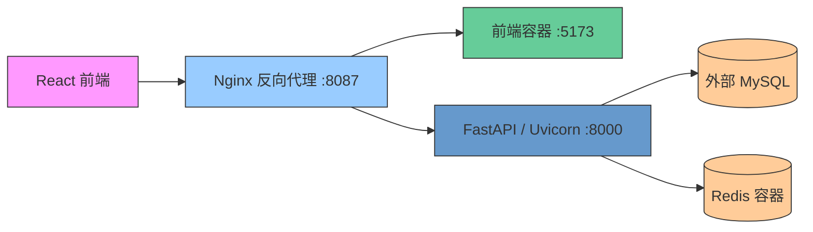

# SMTMS — Supplier Material Traceability Management System


SMTMS 是一個製造業供應商、物料與進料品質管理示範系統。它把供應商及供料關係、供應商批號、收料、內部批號、IQC 檢驗與品質異常記錄連成可查詢的資料流程，協助使用者追查物料來源與品質處理歷程。

此專案展示 FastAPI 後端、關聯式資料建模、流程與數量驗證、RBAC 權限控制，以及前後端測試和 CI。專案定位為可在本機操作的工程作品，不代表已完成正式生產環境認證或負載驗證。

## Demo

目前 README 尚無實際執行畫面。之後可在此補上由本機 Demo 擷取的真實畫面；不使用合成介面圖片。

本機 Demo 可由登入頁開始，依權限操作供應商、物料、收料、內部分批、IQC、品質異常、追溯與角色管理。初始化帳號由 Seeder 建立，密碼由本機環境變數 `SMTMS_SEED_PASSWORD` 設定（請勿在 README 或 Git 提交密碼）。

## 功能與實作範圍

| 功能 | 已實作內容 | 程式碼／驗證依據 |
| --- | --- | --- |
| 供應商與物料管理 | 供應商及物料主檔、供應商供料關聯；供應商資格文件與受控附件 API；另有供應商 Excel 匯入預覽與確認 API | `backend/app/api/routes/suppliers.py`、`materials.py`、`backend/tests/test_catalog_api.py`、`test_supplier_import.py` |
| 收料與批號管理 | 建立供應商批號及收料；收料驗證批號關聯與申報剩餘量；收料可拆分為多個內部批號，並驗證可拆數量 | `backend/app/api/routes/quality.py`、`backend/tests/test_quality_workflow_api.py` |
| 進料檢驗（IQC） | IQC 紀錄建立與更新、受規則限制的檢驗狀態；另提供品保審核清單、核准／退回及審核歷程，退回需理由 | `quality.py`、`backend/tests/test_quality_workflow_api.py` |
| 品質異常管理 | 異常案件查詢、建立與更新、調查狀態流轉、處置紀錄、歷程及受控附件；可連結供應商、物料、收料、批號或 IQC | `backend/app/api/routes/nonconformances.py`、`backend/app/models/quality.py`、`backend/tests/test_quality_workflow_api.py` |
| 物料追溯 | 以供應商批號、收料單、內部批號、IQC ID 或物料代碼查詢關聯流程；結果分頁，前端 CSV 匯出目前結果頁 | `quality.py` 的 `/traceability`、`frontend/src/pages/TraceabilityPage.tsx`、`test_quality_workflow_api.py` |
| 稽核紀錄 | 記錄重要 ORM 建立／更新／刪除與成功登入；後台依 `audit:read` 權限查詢，支援操作者、操作類型、資源及時間範圍篩選、分頁、唯讀異動明細與 CSV 串流匯出 | `backend/app/services/audit.py`、`backend/app/api/routes/audit.py`、`frontend/src/pages/AuditLogPage.tsx`、`backend/tests/test_audit_api.py` |
| 角色與權限管理 | 使用者、角色、權限及角色指派 API；前端依權限保護頁面，後端 API 另行授權；供應商帳號依綁定的供應商範圍隔離 | `backend/app/api/routes/access.py`、`backend/app/core/security.py`、`frontend/src/App.tsx`、`backend/tests/test_access_control_api.py`、`test_supplier_isolation.py` |

以上列出程式碼與測試中可查證的範圍。附件目前存於後端設定的本機持久化目錄，限制格式與大小；尚未包含病毒掃描或外部物件儲存。追溯頁 CSV 僅匯出當前頁；Audit Log CSV 依目前篩選條件分批串流匯出所有符合紀錄。正式部署、長時間負載與合規認證尚未完成。

## 核心設計

- **資料關聯：** `supplier_materials` 描述供應商供料關係；`supplier_lots`、`material_receipts`、`internal_material_lots`、`iqc_records` 逐層連結物料來源、收料、內部分批與檢驗；`quality_reviews` 保存 IQC 核准／退回決策歷程。
- **流程約束：** 收料累計量不可超過供應商批號申報量，內部拆批不可超過收料剩餘量；建立關聯紀錄時會檢查連結對象是否一致。
- **權限邊界：** API 以權限依賴檢查操作權限，供應商帳號依 `supplier_id` 限制資料範圍。前端路由權限檢查用於介面導覽，後端仍負責 API 授權。
- **異常與審核歷程：** IQC 審核決策另存為歷程；異常案件保留變更歷程及處置紀錄，並可關聯至追溯資料。

## 技術架構與堆疊



- **前端：** React 19、TypeScript、Vite 8、React Router 7、Tailwind CSS 4；測試使用 Vitest 與 Testing Library。
- **後端：** Python `>=3.12,<3.14`、FastAPI、Pydantic 2、SQLAlchemy 2、Alembic、Uvicorn；依賴版本範圍及鎖定版本分別見 `backend/pyproject.toml`、`backend/uv.lock`。
- **資料與認證：** MySQL（PyMySQL）、Redis、JWT（PyJWT）；Redis 用於 JWT 撤銷狀態。
- **執行與品質：** Docker Compose 啟動 Redis、後端、前端及 Nginx；MySQL 必須外部提供。後端使用 pytest、Ruff、mypy；前端使用 Vitest、oxlint、TypeScript 與 Vite build。

## 本機啟動與 Demo 初始化

### 前置條件

- Python 3.12 或 3.13 與 [uv](https://docs.astral.sh/uv/)
- Node.js 20.19+ 與 npm（CI 使用 Node.js 20；Vite 8 的版本需求見 `frontend/package-lock.json`）
- MySQL 8 相容資料庫，並建立專用的 `smtms` 開發資料庫及使用者
- Redis 7（可由 Compose 啟動）
- Docker Compose（若要使用容器啟動）

> ⚠️ **重要聲明**：MySQL 不在 `docker-compose.yml` 中建立。請先啟動外部 MySQL，並確保後端可連線。不要將 `.env`、密碼、Token 或含機密的連線字串提交至 Git。

### 設定環境

```powershell
Copy-Item backend/.env.example backend/.env
```

編輯本機 `backend/.env` 的 `DATABASE_URL`，填入 MySQL 連線資訊；`SECRET_KEY` 請換成至少 32 字元的隨機值，`SMTMS_SEED_PASSWORD` 請設成本機 Seeder 測試密碼（至少 12 字元）。`.env.example` 只提供佔位值，不可直接當作安全密碼使用。

#### 環境差異說明
- **直接在 Windows 主機執行後端**：`127.0.0.1` 可指向本機 MySQL 與 Redis
- **使用 Docker Compose**：容器內的 `127.0.0.1` 指向容器本身，請將資料庫主機改為 Docker Desktop 的 `host.docker.internal`。Compose 會自動覆寫 `REDIS_URL` 為其內部 Redis 服務位址 `redis://redis:6379/0`。

### 安裝、遷移及建立示範資料（僅本機開發適用）

> ⚠️ **本機開發專用**：此步驟僅適用於直接在 Windows 主機執行前後端的場景。若使用 Docker Compose，請參閱下方的容器啟動說明。

在專案根目錄執行：

```powershell
Set-Location backend
uv sync --group dev
# 檢查當前資料庫遷移版本
uv run python -m alembic -c alembic.ini current
# 套用所有遷移
uv run python -m alembic -c alembic.ini upgrade head
# 設定 Seeder 密碼並執行資料植入
$env:SMTMS_SEED_PASSWORD = "請設定本機測試密碼(至少12字元)"
uv run python scripts/seed_dev.py
```

#### Seeder 安全限制
Seeder 僅允許在下列條件下執行：
1. `APP_ENV=development` 或 `test` 環境
2. 連線至本機 `localhost:3306/smtms` 資料庫
3. 資料庫處於預期的 Alembic 遷移版本

> ❗️ 容器環境中 Seeder 預設會阻擋執行，因為容器內資料庫主機為 `host.docker.internal`，不符合 Seeder 的安全檢查。若要在容器中執行 Seeder，請參閱 `backend/README.md` 進一步說明。

### 啟動服務

#### 方式一：Docker Compose 完整棧（推薦 Demo 使用）

MySQL 仍須由外部提供，Compose 只會啟動 Redis、後端、前端及 Nginx：

```powershell
Set-Location C:\laragon\www\smtms
docker compose up --build
```

啟動後的存取位址：
- 系統入口：`http://127.0.0.1:8087/`（Nginx 反向代理）
- API 文件（Nginx 代理）：`http://127.0.0.1:8087/docs`
- 直接存取後端：`http://127.0.0.1:8000/docs`
- 直接存取前端開發伺服器：`http://127.0.0.1:5173/`

#### 方式二：本機開發伺服器（開發除錯適用）

先確保 MySQL 與 Redis 已在本機運作，並在一個終端機啟動後端：

```powershell
Set-Location C:\laragon\www\smtms\backend
uv sync --group dev
uv run uvicorn app.main:app --reload --host 127.0.0.1 --port 8000
```

再於另一個終端機啟動前端：

```powershell
Set-Location C:\laragon\www\smtms\frontend
npm ci
npm run dev
```

Vite 開發伺服器預設在 `http://localhost:5173/`。前端 API Base URL 由 `frontend/src/api/client.ts` 讀取環境變數 `VITE_API_BASE_URL`，若未設定則預設為 `http://localhost:8000`。

## 驗證與品質檢查

### 程式碼格式化與品質檢查
本專案後端採用 **Ruff** 作為統一的程式碼格式化、Import 排序與 Lint 檢查工具，取代傳統的 black、flake8、isort 等多工具組合，提供快速且一致的程式碼品質控管。

#### VS Code 自動化設定
需先安裝並啟用 VS Code 的 [Ruff 擴充套件](https://marketplace.visualstudio.com/items?itemName=charliermarsh.ruff)，本機 `.vscode/settings.json` 已預設下列自動化行為，存檔時會自動執行：
1. **自動格式化**：套用 Ruff 的格式化規則（對應 `editor.formatOnSave`）
2. **Import 排序**：自動整理與排序 Python 匯入的模組（對應 `source.organizeImports`）
3. **自動修正**：修復所有 Ruff 支援自動修正的 Lint 問題（對應 `source.fixAll`）

#### 無法自動修正的問題
下列類型的問題無法由 Ruff 自動修正，仍需人工檢查與處理：
- 型別錯誤（需透過 mypy 檢查）
- 邏輯錯誤與業務規則違反
- 複雜的程式碼結構問題
- 部分 Lint 規則無法自動修復的警告
- 資料庫關聯性與業務流程的一致性問題

#### 手動執行指令（需在 backend 目錄下執行）
```powershell
# 僅檢查程式碼風格與 Lint 問題，不進行修正
uv run ruff check .

# 自動修正所有可修復的 Lint 問題
uv run ruff check --fix .

# 執行程式碼格式化
uv run ruff format .

# 合併執行：先修正 Lint 問題再格式化
uv run ruff check --fix . ; uv run ruff format .
```

#### Ruff 規則設定（backend/pyproject.toml）
目前專案的 Ruff 設定完全對應 `backend/pyproject.toml` 中的實際配置：
- **基礎設定**：
  - 行寬：`line-length = 100`
  - 檢查來源：僅針對 `app/` 與 `tests/` 目錄
  - 排除目錄：`.venv`、`__pycache__`、`.pytest_cache`、`.ruff_cache`
- **啟用的 Lint 規則**：
  - `E`（pycodestyle 錯誤）
  - `F`（Pyflakes 錯誤）
  - `I`（Import 排序）
  - `W`（pycodestyle 警告）
  - `C4`（複雜度檢查）
  - `RUF`（Ruff 自訂規則）
- **忽略的規則**：
  - `RUF012`（忽略非同步類別屬性相關警告）
- **格式化設定**：
  - 引號樣式：雙引號（`quote-style = "double"`）
  - 縮排樣式：空格（`indent-style = "space"`）
  - 換行符號：LF（`line-ending = "lf"`）

### 完整驗證指令
以下是專案設定及 CI 工作流程實際執行的完整檢查指令，清楚區分不同層級的驗證：

```powershell
# 後端（backend 目錄；測試需可用的 MySQL、Redis 與測試環境設定）
uv run ruff check .          # 程式碼風格檢查（Lint）
uv run mypy app/             # 靜態型別檢查
uv run pytest -q             # 功能測試驗證

# 前端（frontend 目錄）
npm run lint                 # oxlint 程式碼檢查
npx tsc --noEmit             # TypeScript 型別檢查
npm test                     # Vitest 單元測試
npm run build                # 生產建置驗證
```

CI 工作流程與資料庫／Redis 測試服務定義見 [`.github/workflows/ci.yml`](.github/workflows/ci.yml)。完整後端環境設定及 Seeder 限制見 [`backend/README.md`](backend/README.md)，前端說明見 [`frontend/README.md`](frontend/README.md)。正式規格入口為 [`docs/01_SRS.md`](docs/01_SRS.md)，並包括[領域規則](docs/02_DOMAIN_RULES.md)、[API 契約](docs/04_API_CONTRACT.md)、[資料庫結構](docs/05_DATABASE_SCHEMA.md)、[目前實作狀態](docs/06_CURRENT_STATE.md)、[驗收標準](docs/07_ACCEPTANCE.md)及[開發路線圖](docs/08_ROADMAP.md)。

目前文件記錄的驗收結果：前端 Vitest **32 項通過**（5 個測試檔），Audit Log 頁面測試 **3 項通過**，production build 通過；後端驗收相關測試 **42 項中 1 項略過，其餘通過**，另有 Audit Log 交易一致性／敏感欄位遮蔽與 CSV 安全單元測試 **2 項通過**。Audit Log API 的 Windows TestClient 權限及串流端對端測試、真實 MySQL／Redis 與大量資料吞吐仍待整合環境驗收。詳見[驗收標準](docs/07_ACCEPTANCE.md)與[目前實作狀態](docs/06_CURRENT_STATE.md)。

## 專案結構

```text
backend/                 FastAPI API、模型、Alembic 遷移、Seeder 與測試
frontend/                React/TypeScript UI 與前端測試
docker/nginx/            Nginx 反向代理設定
docker-compose.yml       Redis、backend、frontend、Nginx 服務定義
docs/                    領域規則、API 契約、資料庫結構、現況、驗收與路線圖
```