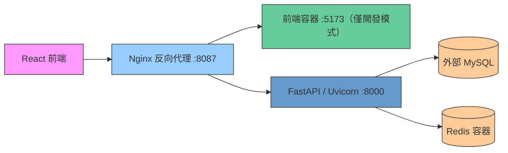

# SMTMS — Supplier Material Traceability Management System

SMTMS 是一個製造業供應商、物料與進料品質管理示範系統。它把供應商及供料關係、供應商批號、收料、內部批號、IQC 檢驗與品質異常記錄連成可查詢的資料流程，協助使用者追查物料來源與品質處理歷程。

此專案展示 FastAPI 後端、關聯式資料建模、流程與數量驗證、RBAC 權限控制，以及前後端測試。專案定位為可在本機操作的工程作品，不代表已完成正式生產環境認證或負載驗證。

## Demo

目前 README 尚無實際執行畫面。之後可在此補上由本機 Demo 擷取的真實畫面；不使用合成介面圖片。

本機 Demo 可由登入頁開始，依權限操作供應商、物料、收料、內部分批、IQC、品質異常、追溯與角色管理。初始化帳號由 Seeder 建立，密碼由本機環境變數 `SMTMS_SEED_PASSWORD` 設定（請勿在 README 或 Git 提交密碼）。

## 功能與實作範圍

下表僅列出程式碼與測試中可查證的範圍。每欄的「依據」指向實際檔案；測試狀態以 `docs/07_ACCEPTANCE.md` 與 `docs/06_CURRENT_STATE.md` 記錄為準，並區分「已自動化測試」、「部分測試」與「未自動化測試」。

| 功能 | 已實作內容 | 程式碼／驗證依據 | 測試狀態 |
| --- | --- | --- | --- |
| 供應商與物料管理 | 供應商及物料主檔、供應商供料關聯；供應商資格文件與受控附件 API；供應商 Excel 匯入預覽與確認 API | `backend/app/api/routes/suppliers.py`、`materials.py`、`backend/tests/test_catalog_api.py`、`test_supplier_import.py` | 已自動化測試 |
| 收料與批號管理 | 建立供應商批號及收料；收料驗證批號關聯與申報剩餘量；收料可拆分為多個內部批號，並驗證可拆數量 | `backend/app/api/routes/quality/receipts.py`、`backend/tests/test_quality_workflow_api.py` | 建立、清單、明細已測試；拆分超量及重複批號已測試，`qty<=0` 分支未單獨驗證 |
| 進料檢驗（IQC） | IQC 紀錄建立與更新、受規則限制的檢驗狀態；品保審核清單、核准／退回及審核歷程，退回需理由 | `backend/app/api/routes/quality/iqc.py`、`backend/tests/test_quality_workflow_api.py` | 已自動化測試；`PATCH /iqc/{id}` 關聯一致性驗證缺失（CURRENT_STATE D4） |
| 品質異常管理 | 異常案件查詢、建立與更新、調查狀態流轉、處置紀錄、歷程及受控附件；可連結供應商、物料、收料、批號或 IQC | `backend/app/api/routes/nonconformances.py`、`backend/app/models/quality.py`、`backend/tests/test_quality_workflow_api.py` | 基本流程已測試 |
| 物料追溯 | 以供應商批號、收料單、內部批號、IQC ID 或物料代碼查詢關聯流程；結果分頁；前端僅匯出當前頁結果 | `backend/app/api/routes/quality/traceability.py`、`frontend/src/pages/TraceabilityPage.tsx`、`backend/tests/test_quality_workflow_api.py`、`test_supplier_isolation.py` | API 已測試；`GET /trace/{lot_no}` 規格存在於 `docs/04_API_CONTRACT.md` 但列為未實作，與實際路由需以程式碼為準 |
| 稽核紀錄 | 記錄重要 ORM 建立／更新／刪除與成功登入；後台依 `audit:read` 權限查詢，支援操作者、操作類型、資源及時間範圍篩選、分頁、唯讀異動明細與 CSV 串流匯出 | `backend/app/services/audit.py`、`backend/app/api/routes/audit.py`、`frontend/src/pages/AuditLogPage.tsx`、`backend/tests/test_audit_api.py` | 核心交易／敏感欄位遮蔽／CSV 安全單元測試 2 項通過；Windows TestClient 權限及串流端對端測試待整合環境驗收 |
| 角色與權限管理 | 使用者、角色、權限及角色指派 API；前端依權限保護頁面，後端 API 另行授權；供應商帳號依綁定的供應商範圍隔離 | `backend/app/api/routes/access.py`、`backend/app/core/security.py`、`frontend/src/App.tsx`、`backend/tests/test_access_control_api.py`、`test_supplier_isolation.py` | 已自動化測試 |
| 認證與 Token | 登入核發 Access Token 與 Refresh Token；`/api/v1/auth/refresh` 輪替 Refresh Token 並核發新 Access Token；`/api/v1/auth/logout` 撤銷當前 Access Token；前端於 401 時自動刷新並重試請求；登入適用 Redis 固定視窗速率限制 | `backend/app/api/routes/auth.py`、`backend/app/schemas/auth.py`、`backend/app/core/login_rate_limit.py`、`frontend/src/api/client.ts`、`frontend/src/api/auth.ts`、`backend/tests/test_refresh_token_api.py`、`test_login_rate_limit_api.py` | 已自動化測試 |

附件目前存於後端設定的本機持久化目錄，限制格式與大小；尚未包含病毒掃描或外部物件儲存。追溯頁 CSV 僅匯出當前頁；Audit Log CSV 依目前篩選條件分批串流匯出所有符合紀錄。正式部署、長時間負載與合規認證尚未完成。

## 核心設計

- **資料關聯：** `supplier_materials` 描述供應商供料關係；`supplier_lots`、`material_receipts`、`internal_material_lots`、`iqc_records` 逐層連結物料來源、收料、內部分批與檢驗；`quality_reviews` 保存 IQC 核准／退回決策歷程。
- **流程約束：** 收料累計量不可超過供應商批號申報量，內部拆批不可超過收料剩餘量；建立關聯紀錄時會檢查連結對象是否一致。
- **權限邊界：** API 以權限依賴檢查操作權限，供應商帳號依 `supplier_id` 限制資料範圍。前端路由權限檢查用於介面導覽，後端仍負責 API 授權。
- **異常與審核歷程：** IQC 審核決策另存為歷程；異常案件保留變更歷程及處置紀錄，並可關聯至追溯資料。

## 認證與 Token

- **Access Token：** 由 `/api/v1/auth/login` 核發，有效期限預設 60 分鐘（`access_token_expire_minutes`）；前端以 Bearer Token 呼叫 API。
- **Refresh Token：** 登入同時核發，有效期限預設 30 天（`refresh_token_expire_days`），以 SHA-256 雜湊儲存於 `refresh_tokens` 資料表；JWT 類型為 `refresh`。
- **更新流程：** 前端收到 401 時呼叫 `/api/v1/auth/refresh`，後端驗證 JWT 與資料庫紀錄（未撤銷、未過期、使用者仍啟用），撤銷舊 Refresh Token 並核發新的 Access Token 與 Refresh Token（輪替）。偵測到 Refresh Token 重複使用時會撤銷該帳號全部有效 Refresh Token。
- **失效與登出：** Refresh Token 過期、撤銷或使用者停用時刷新失敗；`/api/v1/auth/logout` 撤銷當前 Access Token（Redis 撤銷狀態）。
- **登入速率限制：** 登入端點適用 Redis 固定視窗速率限制，分 IP 與帳號兩維度計數，Redis 不可用時失閉回 503；相關環境變數 `LOGIN_RATE_LIMIT_*` 見 `backend/.env.example`。
- **相關端點：** `POST /api/v1/auth/login`、`POST /api/v1/auth/refresh`、`POST /api/v1/auth/logout`、`GET /api/v1/auth/me`、`POST /api/v1/auth/change-password`。
- **資料庫遷移：** `alembic/versions/20261105_refresh_tokens.py` 建立 `refresh_tokens` 資料表；執行 `alembic upgrade head` 套用。
- **環境設定：** `SECRET_KEY`（至少 32 字元）、`access_token_expire_minutes`、`refresh_token_expire_days` 由 `backend/.env` / Settings 設定。

## 技術架構與堆疊



- **前端：** React 19.2.8、TypeScript ~6.0.2、Vite 8.3.0、React Router 7.18.4、Tailwind CSS 4.1.14、Ant Design 6.7.0、TanStack Query 5.105.0；測試使用 Vitest 5.0.5 與 Testing Library，Linter 為 oxlint 1.81.0；套件管理工具 pnpm 9.15.9，鎖定檔 `frontend/pnpm-lock.yaml`。
- **後端：** Python `>=3.12,<3.14`（容器鏡像 `python:3.12-slim`）、FastAPI、Pydantic 2、SQLAlchemy 2、Alembic、Uvicorn；PyMySQL、Redis、PyJWT、bcrypt；Redis 用於 JWT 撤銷狀態與登入速率限制。依賴版本範圍及鎖定版本分別見 `backend/pyproject.toml`、`backend/uv.lock`。
- **資料庫：** MySQL 8.x，為外部服務，**不在 `docker-compose.yml` 中建立**，需先行提供並讓後端可連線。
- **執行與品質：** Docker Compose 啟動 Redis、後端、前端及 Nginx；後端使用 pytest、Ruff、mypy；前端使用 Vitest、oxlint、TypeScript 與 Vite build。

### 關於 CI / GitHub Actions

CI 工作流程定義於 `.github/workflows/ci.yml`，觸發時機為 push 或 pull request 到 `main` / `master` 分支：

- **後端工作**：Python 3.12，`uv sync --locked --group dev` 安裝依賴；執行 `ruff check .`、`mypy app/`、`alembic upgrade head`，再以 `pytest -q` 執行測試。服務容器提供 MySQL 8.0 與 Redis 7（非記憶體 SQLite／假 Redis）。最後建置後端 Docker 映像並以 `curl` 驗證 `openapi.json` 可存取。
- **前端工作**：Node.js 20，`pnpm install --frozen-lockfile` 安裝依賴；執行 `pnpm run lint`（oxlint）、`pnpm exec tsc --noEmit`、`pnpm test -- --run`（Vitest）、`pnpm run build`（生產建置）。

相關本機重現指令詳見 `docs/github-actions.md`。CI 測試環境使用真實 MySQL 與 Redis 服務容器，與 `docs/06_CURRENT_STATE.md` 所記載的「記憶體 SQLite 與假 Redis」不一致，以 `.github/workflows/ci.yml` 實際內容為準。CI 徽章未加入，因無法確認 repository 名稱與當前執行狀態，避免過度宣稱。

## 本機啟動與 Demo 初始化

### 前置條件

- Python 3.12 或 3.13 與 [uv](https://docs.astral.sh/uv/)
- Node.js 20.19+ 與 pnpm（建議透過 Corepack 管理；CI 使用 Node.js 20；Vite 8 的版本需求見 `frontend/pnpm-lock.yaml`）
- MySQL 8 相容資料庫，並建立專用的 `smtms` 開發資料庫及使用者
- Redis 7（可由 Compose 啟動）
- Docker Compose（若要使用容器啟動）

> ⚠️ **重要聲明**：MySQL 不在 `docker-compose.yml` 中建立。請先啟動外部 MySQL，並確保後端可連線。不要將 `.env`、密碼、Token 或含機密的連線字串提交至 Git。

### 設定環境

```powershell
Copy-Item backend/.env.example backend/.env
```

編輯本機 `backend/.env` 的 `DATABASE_URL`，填入 MySQL 連線資訊；`SECRET_KEY` 請換成至少 32 字元的隨機值，`SMTMS_SEED_PASSWORD` 請設成本機 Seeder 測試密碼（至少 12 字元）。`.env.example` 只提供佔位值，不可直接當作安全密碼使用。

#### 環境差異說明
- **直接在 Windows 主機執行後端**：`127.0.0.1` 可指向本機 MySQL 與 Redis
- **使用 Docker Compose**：容器內的 `127.0.0.1` 指向容器本身，請將資料庫主機改為 Docker Desktop 的 `host.docker.internal`。Compose 會自動覆寫 `REDIS_URL` 為其內部 Redis 服務位址 `redis://redis:6379/0`。

### 安裝、遷移及建立示範資料（僅本機開發適用）

> ⚠️ **本機開發專用**：此步驟僅適用於直接在 Windows 主機執行前後端的場景。若使用 Docker Compose，請參閱下方的容器啟動說明。

在專案根目錄執行：

```powershell
Set-Location backend
uv sync --group dev
# 檢查當前資料庫遷移版本
uv run python -m alembic -c alembic.ini current
# 套用所有遷移
uv run python -m alembic -c alembic.ini upgrade head
# 設定 Seeder 密碼並執行資料植入
$env:SMTMS_SEED_PASSWORD = "請設定本機測試密碼(至少12字元)"
uv run python scripts/seed_dev.py
```

#### Seeder 安全限制
Seeder 僅允許在下列條件下執行：
1. `APP_ENV=development` 或 `test` 環境
2. 連線至本機 `localhost:3306/smtms` 資料庫
3. 資料庫處於預期的 Alembic 遷移版本

> ❗️ 容器環境中 Seeder 預設會阻擋執行，因為容器內資料庫主機為 `host.docker.internal`，不符合 Seeder 的安全檢查。若要在容器中執行 Seeder，請參閱 `backend/README.md` 進一步說明。

### 啟動服務

#### 方式一：Docker Compose 完整棧（推薦 Demo 使用）

MySQL 仍須由外部提供，Compose 只會啟動 Redis、後端、前端及 Nginx：

##### 開發模式（保留 Vite Dev Server、HMR、原始碼掛載）
```powershell
Set-Location C:\laragon\www\smtms
docker compose -f docker-compose.yml -f docker-compose.dev.yml up -d --build
```

啟動後的存取位址：
- 系統入口：`http://127.0.0.1:8087/`（Nginx 反向代理）
- Vite 開發伺服器：`http://127.0.0.1:5173/`
- API 文件（Nginx 代理）：`http://127.0.0.1:8087/docs`
- OpenAPI：`http://127.0.0.1:8087/openapi.json`
- 健康檢查：`http://127.0.0.1:8087/health`

##### 正式模式（使用 Nginx 靜態檔案、不啟動 Vite Dev Server）
```powershell
Set-Location C:\laragon\www\smtms
docker compose -f docker-compose.yml -f docker-compose.prod.yml up -d --build
```

啟動後的存取位址：
- 系統入口：`http://127.0.0.1:8087/`（Nginx 反向代理，提供 build 後的靜態檔案）
- API 文件（Nginx 代理）：`http://127.0.0.1:8087/docs`
- OpenAPI：`http://127.0.0.1:8087/openapi.json`
- 健康檢查：`http://127.0.0.1:8087/health`

> 注意：開發與正式模式必須使用對應的 `-f docker-compose.yml -f docker-compose.dev.yml` 或 `-f docker-compose.yml -f docker-compose.prod.yml` 組合。正式模式下前端容器以 `target: production` 建置並由 Nginx 靜態檔案服務；開發模式則啟動 Vite Dev Server。

#### 方式二：本機開發伺服器（不使用 Docker，開發除錯適用）

適用於直接在本機執行前後端，不經由 Docker Compose。

前置條件：MySQL 與 Redis 已在本機運作。

##### 1) 啟動後端（終端機 1）

```powershell
Set-Location C:\laragon\www\smtms\backend
uv sync --group dev
uv run uvicorn app.main:app --reload --host 127.0.0.1 --port 8000
```

再於另一個終端機啟動前端：

```powershell
Set-Location C:\laragon\www\smtms\frontend
corepack enable
pnpm install --frozen-lockfile
pnpm run dev
```

Vite 開發伺服器預設在 `http://localhost:5173/`。前端 API Base URL 由 `frontend/src/api/client.ts` 讀取環境變數 `VITE_API_BASE_URL`，若未設定則預設為 `http://localhost:8000`。

## 驗證與品質檢查

### 程式碼格式化與品質檢查

後端採用 **Ruff** 作為程式碼格式化、Import 排序與 Lint 檢查工具；前端採用 **oxlint** 與 TypeScript `tsc --noEmit`。

#### 手動執行指令（後端，於 backend 目錄下執行）

```powershell
# 僅檢查程式碼風格與 Lint 問題，不進行修正
uv run ruff check .

# 自動修正所有可修復的 Lint 問題
uv run ruff check --fix .

# 執行程式碼格式化
uv run ruff format .

# 靜態型別檢查
uv run mypy app/

# 功能測試
uv run pytest -q
```

#### 手動執行指令（前端，於 frontend 目錄下執行）

```powershell
# oxlint 程式碼檢查
pnpm run lint

# TypeScript 型別檢查
pnpm exec tsc --noEmit

# Vitest 單元測試
pnpm test -- --run

# 生產建置驗證
pnpm run build
```

### 測試現況（依 docs/07_ACCEPTANCE.md 記錄）

以下結果來自專案文件記錄，未在此環境中重新執行，僅供參考：

- 後端驗收相關測試：42 項中 1 項略過，其餘通過（exit code 0）；`tests/test_quality_workflow_api.py` 獨立執行 31 passed、0 failed。
- Audit Log 後端單元測試（CSV 公式注入／引號、交易回滾與敏感欄位遮蔽）：2 項通過。
- 前端 Vitest：32 項通過（測試檔位於 `frontend/tests/` 與 `frontend/src/lib/`）；Audit Log 頁面測試 3 項通過。
- 前端 production build：記錄為通過。

> 後端測試使用記憶體 SQLite 與假 Redis；外部故障測試以 mock 注入例外，並非實際中斷 MySQL／Redis。前端測試使用 mock API。未在真實 MySQL／Redis 或 Docker Compose 環境執行。Audit Log API 權限與串流端點未能在本機 Windows TestClient 環境完成端對端請求；大量資料實際串流吞吐及 MySQL cursor 行為仍待整合環境驗收。

## 統一 Logging

本專案使用 Python 標準庫 `logging` 模組，所有日誌輸出至 stdout，由 Docker 直接收集。

### 設定 Log Level

- 預設等級：`INFO`
- 透過環境變數 `LOG_LEVEL` 設定，可選值：`DEBUG`、`INFO`、`WARNING`、`ERROR`、`CRITICAL`
- 範例：`LOG_LEVEL=DEBUG`（開發環境啟用詳細追蹤）
- 也可在執行時動態調整：`from app.core.logging import set_log_level; set_log_level("DEBUG")`

### 查看 Docker 日誌

```powershell
# 查看後端容器日誌
docker compose logs backend

# 持續追蹤即時日誌
docker compose logs -f backend
```

日誌格式：`時間 | 等級 | 模組 | 訊息`，例如：
```
2026-11-10 08:33:04 | INFO     | app.main | SMTMS backend is running
```

### 在程式中使用 Logging

```python
from app.core.logging import get_logger

logger = get_logger(__name__)

logger.info("一般資訊")
logger.warning("警告事項")
logger.error("錯誤訊息")
logger.exception("例外（包含完整 traceback）")
```

### SQLAlchemy 日誌

- 透過環境變數 `SQL_ECHO` 控制是否輸出 SQL 語句
- 預設 `false`（正式環境不啟用）
- 開發環境可設定 `SQL_ECHO=true` 進行調試

### VS Code Debugger 除錯

1. 在 `backend/.vscode/launch.json` 中選擇 "Python: FastAPI" 設定
2. 設定斷點於感興趣的程式碼行
3. 按 F5 啟動伺服器並進入除錯模式
4. 或在測試中設定斷點，以 `uv run pytest tests/test_xxx.py -v` 執行除錯

### 資訊安全

日誌中會自動遮蔽以下敏感資訊：`password`、`token`、`secret`、`authorization`、`cookie`、`jwt`、`refresh_token`、`access_token`。

## 專案結構

```text
backend/                 FastAPI API、模型、Alembic 遷移、Seeder 與測試
frontend/                React/TypeScript UI 與前端測試
docker/nginx/            Nginx 反向代理設定
docker-compose.yml       Redis、backend、frontend、Nginx 服務定義（MySQL 為外部服務）
docker-compose.dev.yml   開發模式覆蓋（Vite Dev Server、原始碼掛載）
docker-compose.prod.yml  正式模式覆蓋（前端靜態建置、Nginx 靜態服務）
docs/                    領域規則、API 契約、資料庫結構、現況、驗收與路線圖
```

相關文件：後端說明見 [`backend/README.md`](backend/README.md)，前端說明見 [`frontend/README.md`](frontend/README.md)。正式規格入口為 [`docs/01_SRS.md`](docs/01_SRS.md)，並包括[領域規則](docs/02_DOMAIN_RULES.md)、[API 契約](docs/04_API_CONTRACT.md)、[資料庫結構](docs/05_DATABASE_SCHEMA.md)、[目前實作狀態](docs/06_CURRENT_STATE.md)、[驗收標準](docs/07_ACCEPTANCE.md)及[開發路線圖](docs/08_ROADMAP.md)。